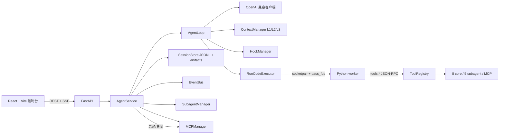

# MiniLLM

**基于 OpenAI 兼容接口的 ReAct Coding Agent**：对 LLM 只暴露一个 `run_code` function tool，模型写 Python 程序，程序里的 `tools.*` 通过 `socketpair` 同步 RPC 回宿主校验/执行；带三级上下文压缩、JSONL 事件溯源与断点恢复、原子写、5 个子 agent 工具、MCP 和 React Web 控制台。


## 核心能力

| 能力 | 本项目实现 | 主要证据 |
|---|---|---|
| ReAct 多轮工具调用 | `AgentLoop` 循环：LLM → run_code → 观察 → 下一轮，直到最终回答/步数/stop | `tests/e2e/test_agent_loop.py`、`tests/unit/test_llm_contract.py` |
| 8 个核心工具 + 注册表 | `ToolRegistry` + `ToolSpec` + pydantic 参数模型；read/write/edit/list/search/bash/web/todo | `tests/unit/test_registry.py`、`uv run minillm tools list --json` |
| Hooks 扩展点 + 技能注入 | `HookManager` 9 个事件；`skills/*/SKILL.md` 按关键词注入 system prompt；审计 hook | `tests/unit/test_hooks.py`、`tests/unit/test_skills.py` |
| 工具参数校验 | pydantic v2 `extra=forbid`；错误结构化返回给模型 | `tests/unit/test_registry.py` |
| 只暴露一个 run_code | LLM 的 function tools 恒为 1 项，schema 只有 `code` | `tests/unit/test_llm_contract.py` |
| 模型写 Python、工具交给 Python 进程 | worker 子进程执行模型代码；`tools.*` 经 socketpair RPC 回宿主；无 TCP/token/hello | `tests/unit/test_bridge.py`、`tests/e2e/test_run_code_subprocess.py` |
| 三级上下文压缩 | L1 工具输出截断落盘；L2 小模型剪枝旧 CoT；L3 超 80% 全量压缩 | `tests/unit/test_context.py`、`tests/unit/test_artifacts.py` |
| 会话隔离 + JSONL + 断点恢复 | 每会话独立 `events.jsonl`，append+fsync；重放恢复；中断 run 补 synthetic | `tests/unit/test_persistence.py`、`tests/e2e/test_agent_loop.py` |
| 文件原子替换 | 临时文件 + `os.replace` + per-path `FileLock` | `tests/unit/test_atomic_write.py` |
| 5 个子 agent 工具 | spawn/send/wait/list/stop；独立会话；`inherit_context` 可选 | `tests/unit/test_subagents.py` |
| MCP | stdio JSON-RPC 2.0（2025-06-18）；`mcp__server__tool` 动态注册 | `tests/unit/test_mcp.py`、`scripts/mcp_stub_server.py` |
| FastAPI + Web | REST + SSE + React 19/Vite 7 控制台 | `tests/unit/test_api.py`、`apps/web` |

> 当前测试规模：200+ 单元与端到端测试，ruff 全绿。详细结果见「测试与验收」。

## 技术栈（关键版本）

| 层 | 选型 | 版本 |
|---|---|---|
| 语言 / 包管理 | CPython / uv | 3.12.14 / 0.12.7 |
| Web 后端 | FastAPI / Starlette / Uvicorn | 0.165.0 / 1.10.0 / 0.54.0 |
| 校验 / 配置 | Pydantic / pydantic-settings | 2.13.5 / 2.16.3 |
| LLM SDK / HTTP | openai / httpx | 3.11.0 / 0.28.1 |
| 测试 / lint | pytest / pytest-asyncio / ruff | 9.2.0 / 1.5.0 / 0.17.6 |
| 前端 | React / Vite / TypeScript | 19.3.1 / 7.3.8 / 5.9.3 |
| 前端运行时 | Node / pnpm | 24.19.0 / 11.22.0 |
| 主模型 / 小模型 | deepseek-v4.1-flash / glm-5.3-flash | OpenCode Go |
| MCP | 自研 stdio JSON-RPC | 2025-06-18 |

Agent 框架为自研（不依赖 LangChain/LangGraph）；版本以 `uv.lock`、`apps/web/pnpm-lock.yaml` 与 `.python-version` 为准。

## 快速开始

### 0. 前置条件

- Linux / POSIX（项目在 Ubuntu 26.04、Python 3.12.14 上开发；`socketpair + pass_fds` 是 POSIX 实现）
- [uv](https://docs.astral.sh/uv/) 0.12.7+、Node 24 / pnpm 11.22+、ripgrep（`search_files` 优先用 `rg`）
- 一个 OpenAI 兼容网关。本项目默认连本机 **OpenCode Go relay**：`http://127.0.0.1:8788/inference/go/v1`；也可改 `LLM_BASE_URL` 指向其他 OpenAI 兼容服务

### 1. 安装 Python 依赖

```bash
git clone git@github.com:147miao/minillm.git
cd minillm
uv sync
```

### 2. 配置

```bash
cp .env.example .env
# 编辑 .env：至少填 LLM_API_KEY；默认 LLM_BASE_URL 指向本机 relay
uv run minillm doctor
```

`minillm doctor` 会打印脱敏配置、请求 `/models` 并列出可用模型；不会打印密钥。

若网关是远端地址，改 `LLM_BASE_URL` / `SMALL_LLM_BASE_URL`；若使用本地 Ollama 等其他 OpenAI 兼容服务，同理。主/小模型可以分别配置 base_url、key、model。

### 3. 构建前端

```bash
cd apps/web
pnpm install --frozen-lockfile
pnpm build
cd ../..
```

构建产物在 `apps/web/dist`，由 FastAPI 在 `/` 托管。开发时可跳过 build，用 Vite 5173 联调。

### 4. 启动 Web 服务

```bash
uv run minillm serve --port 8765
# 浏览器打开 http://127.0.0.1:8765/
# 指定会话直达：http://127.0.0.1:8765/?session=<session_id>
```

### 5. CLI

```bash
uv run minillm tools list                 # 查看 8 core + 5 subagent + MCP
uv run minillm tools list --json
uv run minillm run --workspace ./workspace/demo "创建 greet.py 和 test_greet.py，并运行 pytest"
uv run minillm chat                        # 终端多轮
uv run minillm sessions list
uv run minillm sessions show <session_id>
```

`run` 默认使用真实模型；它会创建一个会话、跑一轮、打印最终回答。`--json` 输出结构化结果（`session_id`、`final_answer`、`events` 摘要）。

### 6. 前端开发模式

一个终端起后端：

```bash
uv run minillm serve --port 8765
```

另一个终端起 Vite：

```bash
cd apps/web
pnpm dev
```

打开 `http://127.0.0.1:5173/`；Vite 会把 `/api` 代理到 8765。

## 架构

### 组件图



### 一次 turn 的数据流

1. 用户消息 `POST /api/sessions/{id}/messages` → `AgentService` 起后台 turn。
2. `AgentLoop` append `user.message`；Hooks 选中技能，注入 system prompt。
3. `ContextManager` 根据上次 usage 判断是否需要 L2/L3；生成当前消息视图。
4. `LLMClient` 以 `tools=[run_code]` 流式请求；`assistant.message` 落盘，SSE 推送 content/reasoning 增量。
5. 若模型返回 `run_code` tool_call：`RunCodeExecutor` 启动 worker，模型 Python 通过 `tools.*` 调工具；每次调用经过 pydantic 校验、Hooks、执行、artifact 落盘与事件审计。
6. 把 `run_code.finished.content` 作为 `role=tool` 消息喂回模型；循环直到无 tool_call、达到 `MAX_STEPS` 或用户 stop。
7. `turn.finished` 落盘；UI 按 SSE 事件更新。

### run_code 桥（socketpair）

```text
AgentLoop ──execute(code, call_id, ctx)──▶ RunCodeExecutor
                                         │ socketpair()
                                         ▼
                              sys.executable -m minillm.runtime.worker --bridge-fd 3
                                         │
                exec 帧（代码 + 工具参数顺序）│
                                         ▼
                                  模型 Python 程序
                                         │ tools.read_file(...)
                                         │ tool_call 帧（JSON 行）
                                         ▼
                              宿主：pydantic 校验 → Hooks → ToolRegistry
                                         │ result / error 帧
                                         ▼
                                   worker 继续执行
                                         │ done / EOF
                                         ▼
                              RunCodeResult → role=tool 消息
```

边界：worker 不继承 `LLM_API_KEY` 等密钥；stdout/stderr 各 1 MiB 上限，给 LLM 的结果按 `RUN_CODE_OUTPUT_CHARS` 截断并落 artifact；空闲超时 120s（工具调用进行中暂停）+ 硬上限 900s，超时 killpg，EOF 自杀，避免孤儿进程。

## 核心设计

### 1. 只给 LLM 一个工具：run_code

LLM 的 function tools 恒为：

```json
{"type":"function","function":{"name":"run_code","parameters":{
  "type":"object","properties":{"code":{"type":"string"}},
  "required":["code"],"additionalProperties":false}}}
```

模型不直接看到 13 个工具，而是在 Python 程序里用 `tools.read_file(...)` 这类同步调用。这样做的收益：

- 工具协议只有一个入口，模型不需要在多工具 schema 之间选择；
- 工具编排（并行/串行、异常处理、数据加工）由模型写的 Python 完成；
- 工具治理（校验、Hooks、原子写、审计、artifact）集中在宿主，只有一份事实来源。

### 2. 工具注册表与 8 个核心工具

| 工具 | 签名 | 说明 |
|---|---|---|
| `read_file` | `(path, start_line=1, limit=2000) -> str` | 读 workspace 内文本，可按行截取 |
| `write_file` | `(path, content) -> dict` | 原子写（临时文件 + os.replace） |
| `edit_file` | `(path, old_string, new_string, replace_all=False) -> dict` | 精确替换，默认要求唯一匹配 |
| `list_files` | `(path='.', pattern='**/*', max_results=200) -> list[str]` | 列文件，忽略依赖/数据目录 |
| `search_files` | `(pattern, path='.', glob=None, max_results=100, context=0) -> list[dict]` | 正则搜索，优先 rg |
| `run_bash` | `(command, cwd=None, timeout=60) -> dict` | workspace 内 bash，超时/输出上限 |
| `web_fetch` | `(url, max_chars=20000) -> str` | 抓取并转文本，默认拒绝私网 |
| `todo_write` | `(items) -> list[dict]` | 全量覆盖待办（pending/in_progress/completed） |

5 个子 agent 工具：`spawn_subagent`、`send_message`、`wait_agent`、`list_agents`、`stop_agent`。MCP 工具动态注册为 `mcp__<server>__<tool>`。

参数校验：每个工具一个 pydantic 模型，`extra=forbid`；失败返回 `ToolError(kind="validation", tool, errors)`，Python 侧抛 `ToolCallError`，模型可以 catch 后修正。

### 3. Hooks 与技能注入

Hook 事件：`session_start`、`user_message`、`before_llm`、`after_llm`、`before_tool`、`after_tool`、`before_compact`、`after_compact`、`turn_end`。

- `before_tool` 可以 deny 或修改参数；`after_tool` 可以替换结果；
- 单个 hook 异常只记日志，不拖垮主流程；
- 内置 `SkillsHook` 扫描 `skills/*/SKILL.md` 的 frontmatter（`name/description/keywords`），按用户消息关键词注入正文，并落 `skills.injected` 事件；
- 内置 `AuditHook` 把工具调用写入 `data/audit.jsonl`（敏感字段脱敏）；
- 用户插件放 `hooks/*.py`，暴露 `register(manager)`；示例见 `examples/hooks/audit_hook.py`。

示例技能：`pytest-debugging`（失败定位流程）、`safe-file-edits`（何时 edit_file、如何原子改）。

### 4. 三级上下文压缩

默认 `CONTEXT_BUDGET=200000`（这是 agent 工作预算，不是模型 1M 窗口），`PRUNE_THRESHOLD=0.5`，`COMPACT_THRESHOLD=0.8`，`KEEP_RECENT_TURNS=6`。

| 级别 | 触发 | 动作 | 事件 |
|---|---|---|---|
| L1 | 单次工具输出 > `MAX_TOOL_OUTPUT_CHARS`(20000) | 截断，完整内容写 `artifacts/`，返回相对路径；run_code 给 LLM 的 content 再按 `RUN_CODE_OUTPUT_CHARS`(8000) 截断 | 无（工具层完成） |
| L2 | usage ≥ 50% 预算 | 小模型把保留窗口外的 reasoning + 工具轨迹压成 ≤200 字摘要；清旧 reasoning，插入摘要 note | `context.compacted level=2`，含 `pruned_upto_seq` |
| L3 | usage ≥ 80% 预算 | 小模型把保留窗口前整段会话压成结构化摘要，保留最近 6 轮原文 | `context.compacted level=3`，含 `kept_message_count` |

- 切点只落在 user 消息前或完整 tool 结果之后，不拆散 `assistant.tool_calls ↔ tool`；
- token 依据优先真实 `usage.prompt_tokens`，否则 CJK 2 chars/token、ASCII 4 chars/token 估算；
- 小模型失败退化为确定性截断；L3 后仍超阈值则硬截断，`fallback` 会记录；
- 原始 JSONL 事件不删除，压缩只影响“下一轮发给 LLM 的视图”。

### 5. JSONL 事件溯源与断点恢复

每个会话独立目录：

```text
data/sessions/<session_id>/
  meta.json
  events.jsonl
  artifacts/
```

事件只 append、先 `flush + fsync` 再广播；状态 = 按 `seq` 重放的结果。关键事件：`session.created`、`user.message`、`assistant.message`、`llm.usage`、`run_code.started/finished`、`tool.call/result`、`context.compacted`、`skills.injected`、`todo.updated`、`subagent.*`、`turn.*`、`agent.error`。

恢复时：

- 重放 `events.jsonl`，恢复 messages/todos/agents/压缩视图；
- 发现 `run_code.started` 无 `finished`，补一条 `synthetic` 结果，告诉模型“服务重启，结果未知”；
- 发现 `tool.call` 无 `tool.result`，同样补 synthetic；
- 不自动重跑中断的 turn（避免重复副作用），用户可继续发消息。

事件协议的核心不变式已在本节说明；具体字段以代码 `src/minillm/events.py` 与 `src/minillm/persistence/replay.py` 为准。

### 6. 原子写与并发

- `write_file`/`edit_file`：目标目录唯一临时文件 → `flush + fsync` → `os.replace` → 尽力 fsync 目录；保留已有 mode；
- 同一绝对路径的读改写由 `FileLockManager` 串行；
- 测试并发写 1MB 内容并持续读，断言读到的永远是完整旧版或完整新版，且无临时文件残留；
- `run_bash` 和外部编辑器不受锁保护；原子替换保证“读者不看到半截文件”，不保证业务层丢失更新。

### 7. 子 agent

5 个工具：

| 工具 | 作用 |
|---|---|
| `spawn_subagent(task, description=None, inherit_context=False)` | 创建独立会话，异步跑子任务 |
| `send_message(agent_id, message)` | 给子 agent 发消息；空闲开新轮，运行中排队 |
| `wait_agent(agent_id=None, timeout=300)` | 等待指定/任一子 agent；超时返回 running |
| `list_agents()` | 列出状态、任务、结果摘要 |
| `stop_agent(agent_id)` | 取消当前任务并标记 stopped |

- 子 agent 有自己的 `session_id` 和 `events.jsonl`，父会话只记摘要级 `subagent.*` 事件；
- `inherit_context=true` 时把父会话当前压缩视图作为 seed 传给子循环（>50% 预算先小模型摘要），不写进子 JSONL；
- 默认 `inherit_context=false`；深度上限 1、并发 4，避免递归/失控；
- 子 agent 的工具权限不含 subagent 工具（不能再 spawn）。

### 8. MCP

- 客户端：stdio JSON-RPC 2.0，协议 `2025-06-18`；生命周期 `initialize → notifications/initialized → tools/list → tools/call`；
- 每个 server 一把串行锁、30s 请求超时、stderr 单独 drain；
- 工具命名 `mcp__<server>__<tool>`，由 `inputSchema` 动态生成 pydantic 参数模型；
- 配置 `mcp.json`（示例 `mcp.json.example`），缺失/单个 server 失败只告警，不阻塞启动；
- `scripts/mcp_stub_server.py` 提供 echo/add/slow，供测试与本地演示。

### 9. Web 与 SSE

- 左：会话列表（含子 agent 层级、状态）；中：对话流、run_code 代码块、嵌套工具卡片、压缩横幅、artifact；右：上下文仪表、todos、子 agent 树、技能/配置；
- SSE 事件：持久事件带 `id: <seq>` 和完整事件 JSON；增量 `assistant.delta/reasoning.delta` 无 id；心跳 `: ping`；
- 客户端按 `seq` 去重、断线用 `after` 重连续传；初始化先 `GET /api/sessions/{id}` 再订阅；
- 只访问 `/api`，不在前端接触模型密钥。

## 配置

完整列表见 [.env.example](.env.example)。常用项：

| 变量 | 默认 | 说明 |
|---|---|---|
| `LLM_BASE_URL` / `LLM_MODEL` | localhost relay / `deepseek-v4.1-flash` | 主模型 |
| `LLM_API_KEY` | 必填 | 只放 `.env`，不入库 |
| `SMALL_LLM_MODEL` | `glm-5.3-flash` | 压缩用的小模型 |
| `INCLUDE_REASONING` | true | 是否回传 reasoning_content |
| `CONTEXT_BUDGET` | 200000 | agent 工作预算 |
| `PRUNE_THRESHOLD` / `COMPACT_THRESHOLD` | 0.5 / 0.8 | L2/L3 阈值 |
| `KEEP_RECENT_TURNS` | 6 | 保留最近轮数 |
| `MAX_TOOL_OUTPUT_CHARS` / `RUN_CODE_OUTPUT_CHARS` | 20000 / 8000 | 截断阈值 |
| `RUN_CODE_IDLE_TIMEOUT` / `RUN_CODE_MAX_TIMEOUT` | 120 / 900 | 桥超时 |
| `BASH_TIMEOUT` / `WEB_FETCH_TIMEOUT` | 60 / 20 | 工具超时 |
| `MAX_STEPS` / `TURN_TIMEOUT` | 40 / 900 | 单轮保护 |
| `DATA_DIR` / `WORKSPACE_ROOT` | ./data / ./workspace | 数据与工作区 |
| `SUBAGENT_MAX_DEPTH` / `SUBAGENT_MAX_CONCURRENT` | 1 / 4 | 子 agent 限制 |
| `MCP_CONFIG` | ./mcp.json | MCP 配置 |
| `WAL_FSYNC` | true | JSONL fsync |
| `HOST` / `PORT` | 127.0.0.1 / 8765 | 服务绑定 |

## HTTP API

| 方法 | 路径 | 作用 |
|---|---|---|
| GET | `/api/health` | 健康检查 |
| GET | `/api/config` | 脱敏配置、模型、阈值、技能、MCP servers |
| GET | `/api/sessions` | 会话列表 |
| POST | `/api/sessions` | 创建会话（201） |
| GET | `/api/sessions/{id}` | meta/messages/todos/agents/context/skills/last_seq/status |
| GET | `/api/sessions/{id}/events?after=` | JSONL 事件回放 |
| POST | `/api/sessions/{id}/messages` | 发送消息（202；运行中 409） |
| POST | `/api/sessions/{id}/stop` | 停止当前 turn |
| GET | `/api/sessions/{id}/stream?after=` | SSE |
| GET | `/api/sessions/{id}/artifacts/{name}` | artifact 下载 |
| GET | `/` | React 构建产物或未构建提示 |

## 测试与验收

### 当前已验证（2026-11-20）

```text
uv run pytest -q tests/unit      → 187 passed
uv run pytest -q tests/e2e       → 17 passed
uv run pytest --collect-only -q  → 204 tests collected
uv run ruff check src tests      → All checks passed!
uv run minillm tools list --json → 13 个工具（8 core + 5 subagent）
uv run minillm doctor            → HTTP 200 + 可用模型列表
uv run minillm serve ...         → /api/health、/api/config、/ 静态页面均正常
```

### 完整验收

完整验收覆盖：

- C1/C2 单元 + 端到端测试；C3 只暴露 run_code；C4 8+5 工具；
- C5 artifact 截断；C6 L2 剪枝；C7 L3 80% 压缩；C8 原子写；C9 MCP；
- C10 重启恢复；C11 SSE/API；C12 前端构建；
- C13 真实网关编码任务（JSONL 有 `tool.call(write_file)` + `run_code.finished`）；
- C14 无密钥入库 + 单文件 ≤700 行。


## 目录

```text
src/minillm/
  config.py errors.py ids.py events.py artifacts.py locks.py net.py
  llm/          OpenAI 兼容客户端 + scripted 测试替身
  tools/        8 个核心工具 + 注册表 + 校验
  runtime/      run_code worker / socketpair 桥 / executor
  hooks/        HookManager + skills/audit 内置 hook
  skills/       SKILL.md 解析/选择/渲染
  persistence/  JSONL store + replay
  agent/        AgentLoop / ContextManager / AgentService / SubagentManager
  mcp/          stdio JSON-RPC 客户端
  api/          FastAPI 路由 + SSE
  cli.py        serve/run/chat/sessions/tools/doctor
apps/web/       React 19 + Vite 7 + TypeScript 控制台
skills/         pytest-debugging / safe-file-edits
scripts/        MCP stub（live smoke/check hygiene 由验收脚本提供）
tests/          unit + e2e
```

## 局限与边界

- `run_code` 是**效率沙箱，不是安全沙箱**：模型可以在 Python 里直接用 `open()/os/socket` 绕过 `tools.*` 的路径校验与原子写；系统提示要求文件修改走 `tools.*`，但真正的安全隔离需要 bwrap/firejail/容器等；
- 服务默认只绑 `127.0.0.1`，无鉴权；不要直接暴露公网；
- `socketpair + pass_fds` 按 POSIX 实现，Windows 未验证；
- MCP 只实现 tools 能力，不做 resources/prompts/sampling；
- 前端目前是单页控制台，没有路由级拆包；构建产物由 FastAPI 托管，开发用 Vite；
- 不提供 Docker 镜像（按项目选择）；不内置数据库，JSONL 就是唯一事实来源。

## 远端

- GitHub：`git@github.com:147miao/minillm.git`
- 分支：`main`

模块职责、桥协议、压缩算法与扩展方式见「架构」「核心设计」与「配置」；运行见「快速开始」。